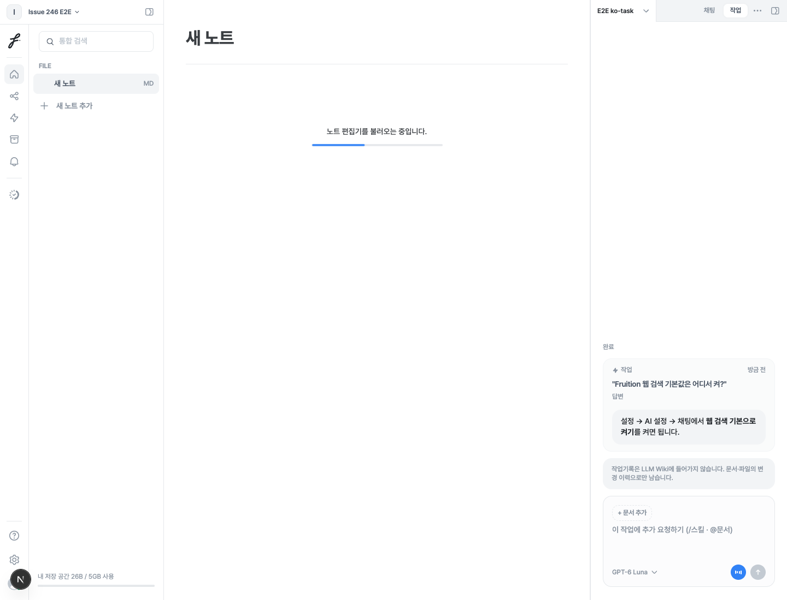
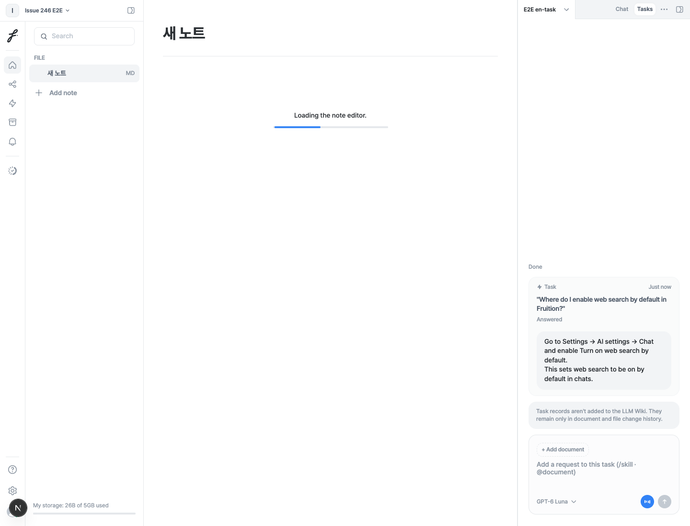

# Product help — reload verification

2026-11-08: real Chromium → API → Kafka → GPT-6 Luna → PostgreSQL → UI, **6/6 passed**.

The [browser runner](../../../web/e2e/README.md) checks Korean/English chat and task help plus ambiguous app clarification. Every case checks the saved answer via the public API and its visibility after reload. Task replies remain in Tasks with `product_help` instead of collapsing into a document-change summary.

[Full report, request IDs, answers, and environment limits](https://github.com/FruitionKR/Fruition-ai/tree/fix/246-product-help-integration/pipeline/evals/product_help/integration).

## Korean, after reload

## English, after reload

